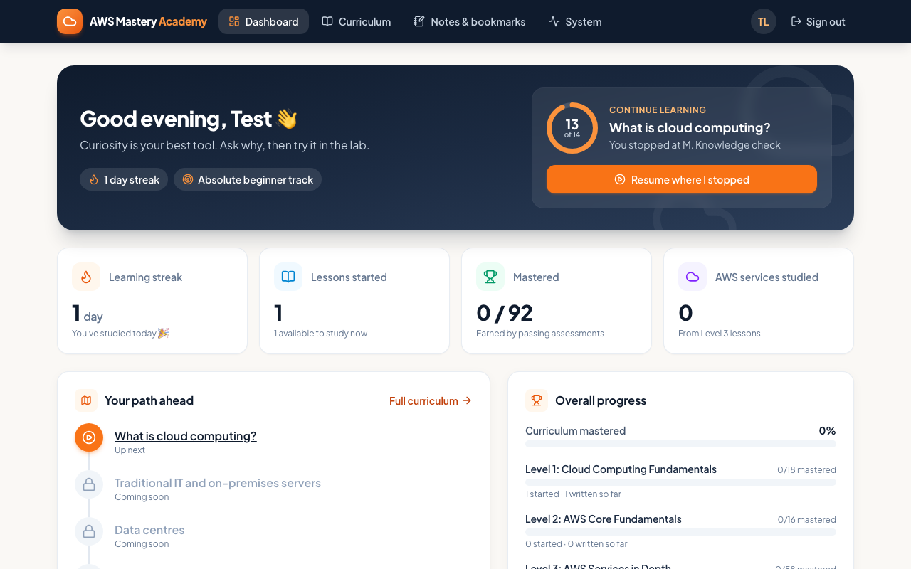
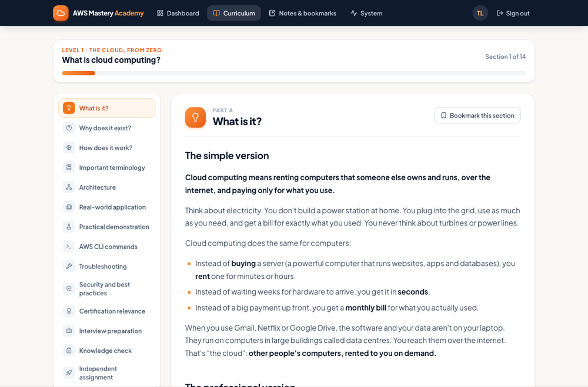
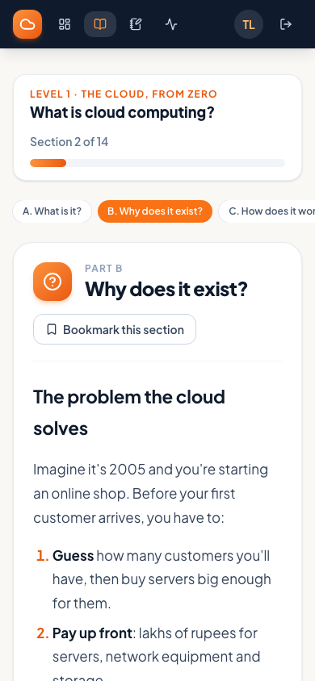

# AWS Mastery Academy

A self-hosted platform for learning AWS from absolute zero to certification level.
Lessons explain every idea simply first, then professionally, and every hands-on command
runs against **Floci**, a local AWS emulator. Nothing ever touches a real AWS account,
so practising costs nothing.



> **Status: work in progress (Phase 3 of 11).** The dashboard, curriculum navigation, lesson viewer,
> notes and bookmarks are built and tested. Lesson 1 (*What is cloud computing?*) is fully written;
> the rest of the curriculum is mapped and shown as "Coming soon". Per-phase reports are in [docs/reports](docs/reports).

## Features

- **Structured curriculum**: 92 lessons over three levels (Cloud Computing Fundamentals, AWS Core Fundamentals, AWS Services in Depth).
- **14-part lessons**: what it is, why it exists, how it works, terminology, architecture, real-world use, a practical demo, AWS CLI commands, troubleshooting, security, certification relevance, interview prep, a knowledge check and an independent assignment.
- **Verified commands**: every CLI command in a lesson is run against Floci before it is published, with the real output included. Any difference between Floci and real AWS is called out.
- **Honest progress tracking**: a lesson counts as *mastered* only after you pass its assessment. Reading it is not enough. Also tracks learning streaks and lets you resume exactly where you stopped.
- **Notes and bookmarks** on any lesson section.
- **Safe by design**: every AWS endpoint must be a loopback URL, or the app refuses to call it. It binds to `127.0.0.1` only and needs no paid services or API keys.
- **Responsive UI** that works on desktop and phone.

<table>
  <tr>
    <td></td>
    <td width="30%"></td>
  </tr>
</table>

## Tech stack

Next.js 16 (App Router, Cache Components) · React 19 · TypeScript · Tailwind CSS 4 ·
PostgreSQL 16 + Drizzle ORM · Zod · Vitest · Playwright

## Requirements

| Tool | Version | Notes |
|---|---|---|
| Node.js | 24 or later | |
| Docker | any runtime (Docker Desktop, Colima, …) | Runs only PostgreSQL. No compose plugin needed. |
| Floci | 2.4.x | Local AWS emulator listening on `http://localhost:4566`. This project never starts, stops or changes it. |

Developed and tested on macOS (Apple silicon).

## Getting started

```bash
git clone https://github.com/satendragoswamii/aws-mastery-academy.git
cd aws-mastery-academy
npm install
npm run setup:env       # creates .env with a random DB password (never overwrites an existing one)
npm run db:up           # starts PostgreSQL on 127.0.0.1:5433
npm run db:migrate      # creates the tables
npm run user:create     # creates your account (prompts for username and password)
npm run dev             # http://127.0.0.1:3000
```

Day to day, just run `npm run db:up` (if Postgres isn't running) and `npm run dev`.

## Scripts

| Script | What it does |
|---|---|
| `npm run dev` | Development server, bound to 127.0.0.1 only |
| `npm run build` / `npm start` | Production build / server (127.0.0.1 only) |
| `npm test` | Unit and integration tests (uses the separate `academy_test` database) |
| `FLOCI_LIVE=1 npm test` | Also checks the live Floci endpoint |
| `npm run build && npm run test:e2e` | Browser tests (Playwright, test database, port 3100) |
| `npm run typecheck` / `npm run lint` | Static checks |
| `npm run db:up` / `db:down` / `db:status` / `db:psql` | Manage the Postgres container |
| `npm run db:generate` | Create a SQL migration after editing `src/db/schema.ts` |
| `npm run db:migrate` | Apply migrations (`-- --test` for the test database) |
| `npm run user:create` / `user:reset-password` | Manage your account |

## Security

- Secrets live only in `.env`, which is git-ignored. `.env.example` contains placeholders only.
- Passwords are hashed with bcrypt. Sessions are stored hashed in the database, and repeated failed logins trigger a lockout.
- No variable is exposed to the browser (nothing uses the `NEXT_PUBLIC_` prefix).
- The app is single-user and designed to run locally. It is not hardened for exposure to the internet.

## Documentation

- [Architecture](docs/ARCHITECTURE.md): components, data model, safety design
- [Development guide](docs/DEVELOPMENT.md): workflow, testing, troubleshooting
- [Phase reports](docs/reports)

## Roadmap

Upcoming phases: the remaining Level 1 and Level 2 lessons, AWS service deep dives, hands-on labs against Floci,
an offline AI instructor (built-in content plus optional local Ollama), assessments and certification practice.
